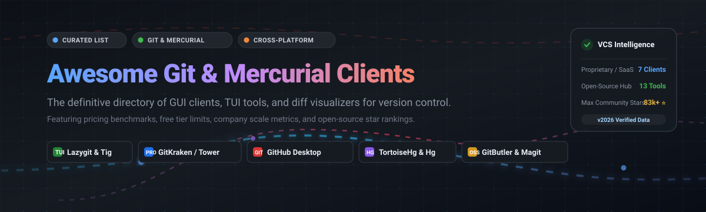

# Awesome-Git-Mercurial-Desktop-Client

# 🚀 Awesome Git & Mercurial Desktop Clients 🛠️

 

**A curated, comprehensive directory of the best Git and Mercurial desktop GUI clients, terminal user interfaces (TUIs), and diff tools.**  
*Benchmarked with transparent commercial pricing models, free-tier limits, company scale valuations, and GitHub star rankings.* ⚡

[Explore SaaS & Proprietary Clients](#-commercial--proprietary-clients) • [Explore Open-Source Software](#-open-source-software) • [Comparison at a Glance](#-comparison-at-a-glance) • [Contributing](#-contributing) • [Support](#-support)

---

## 📋 Table of Contents

- [🌐 Sector Overview & Market Dynamics](#-sector-overview--market-dynamics)
- [🟦 Commercial / Proprietary Clients](#-commercial--proprietary-clients)
  - [📊 SaaS & Commercial Feature Matrix](#-saas--commercial-feature-matrix)
  - [🔍 Detailed Product Breakdown](#-detailed-product-breakdown)
- [🟩 Open-Source Software](#-open-source-software)
  - [⭐ Open-Source Ranked Breakdown](#-open-source-ranked-breakdown)
- [📊 Comparison at a Glance](#-comparison-at-a-glance)
- [🤝 Contributing](#-contributing)
- [💖 Support & Sponsorship](#-support--sponsorship)
- [📈 Star History](#-star-history)
- [📄 License](#-license)

---

## 🌐 Sector Overview & Market Dynamics

The Version Control Systems (VCS) and source code management tooling market is estimated at **$1.22B to $1.48B**, expanding at a Compound Annual Growth Rate (CAGR) of **10.3% to 18.9%** toward **$2.7B+ to $5.8B** by the early 2030s. The industry displays a **two-tier market structure**: the underlying repository hosting layer is heavily concentrated in a winner-take-most dynamic dominated by Microsoft (GitHub), GitLab, and Atlassian (Bitbucket), whereas the desktop client and developer ergonomics layer remains **moderately fragmented**, fostering healthy competition between bootstrapped native GUI daily-drivers (Fork, Sublime Merge, Tower), venture-backed modern workflow engines (GitKraken, GitButler), and community-driven open-source powerhouses (Lazygit, Magit). 📈✨

---

## 🟦 Commercial / Proprietary Clients 💼

Desktop Git and Mercurial clients that are commercially licensed or proprietary-freeware with commercial tiers.

### 📊 SaaS & Commercial Feature Matrix

> 💡 *Sorted in descending order by parent company scale (valuation / annual revenue).*

| 🛠️ Product | 🏢 Parent Company & Scale (Valuation / Revenue) | 🏷️ Starting Tier Pricing | 🎁 Free Tier Limit / Free Plan Scope | 💻 Supported Platforms | 🪐 Mercurial (Hg) |
|:---|:---|:---|:---|:---|:---:|
| **[GitHub Desktop](https://desktop.github.com/)** | **Microsoft / GitHub** `~$3.88T–$3.92T` Market Cap / `$1B+ ARR` | **$0.00** (Included with GitHub Free / Enterprise) | **Free Forever**: Unlimited public & private repositories, unlimited branches & commits. Requires a free GitHub account. No paid desktop tier. | Windows, macOS | ❌ |
| **[Sourcetree](https://www.sourcetreeapp.com/)** | **Atlassian** `~$48B–$56B` Market Cap / `~$4.4B ARR` | **$0.00** (Free proprietary enterprise desktop tool) | **Free Forever**: Full feature set for personal and commercial usage with unlimited repos. Requires signing in with a free Atlassian ID within 30 days. | Windows, macOS | ❌ *(Legacy win32 Hg deprecated; focused on Git)* |
| **[GitKraken](https://www.gitkraken.com/)** | **GitKraken (Resurgens Tech Partners)** `~$10.6M–$15M` ARR (Private Equity Backed) | **$8.00 / user / month** ($96 billed annually for Pro) | **14-day free trial** of Pro/Advanced features; downgrades to Free plan restricted strictly to **local repositories and public remotes** (no private cloud repos, no conflict prevention or AI commit tooling). | Windows, macOS, Linux | ❌ |
| **[Tower](https://www.git-tower.com/)** | **saas.group (formerly fournova Software)** `$100M+` Portfolio ARR / 100k+ Users | **$69.00 / user / year** (~$5.75/mo Basic Tier) | **30-day full-featured free trial**; no permanent free tier. Requires active paid subscription after 30-day evaluation. | Windows, macOS | ❌ |
| **[Fork](https://git-fork.com/)** | **Danil & Tanya Pristupov** `Bootstrapped Boutique` (Independent Dev Studio) | **$59.99 one-time** (Perpetual license for 3 personal machines) | **Uncapped evaluation period**: Full functionality evaluation mode with intermittent license purchase reminders; no hard calendar cutoff. | Windows, macOS | ❌ |
| **[Sublime Merge](https://www.sublimemerge.com/)** | **Sublime HQ Pty Ltd** `Bootstrapped Micro-ISV` (~7–10 Employees) | **$99.00 one-time** (Perpetual license + 3 years of software updates) | **Uncapped evaluation period**: Complete functionality available for evaluation without strict expiration; periodic registration reminder dialogs on commit. | Windows, macOS, Linux | ❌ |
| **[SmartGit](https://www.syntevo.com/smartgit/)** | **syntevo GmbH** `Self-funded Micro-ISV` (~3–5 Employees) | **$5.00 / user / month** (or perpetual options from ~$129) | **30-day commercial free trial**; **Free forever for verified non-commercial hobby use**, registered academic students, and open-source contributors (excludes enterprise Jira/GitHub Enterprise integrations). | Windows, macOS, Linux | ✅ |

### 🔍 Detailed Product Breakdown

#### 🐙 GitHub Desktop
* **Website:** [desktop.github.com](https://desktop.github.com/) 🌐  
* **Company:** Microsoft / GitHub (Scale: ~$3.9T Market Cap) 🏢  
* **Pricing:** Free ($0) 🏷️  
* **Free Tier Limit:** Free forever without seat caps or private repo restrictions. 🎁  
* **Platforms:** Windows, macOS (Community builds for Linux) 💻  
GitHub's official desktop application. Engineered to reduce Git overhead, it streamlines staging, branch creation, commit history inspection, and PR handoff with GitHub. Ideal for developers wanting a frictionless experience without complex plumbing operations.

#### 🌳 Sourcetree
* **Website:** [sourcetreeapp.com](https://www.sourcetreeapp.com/) 🌐  
* **Company:** Atlassian (Scale: ~$50B Market Cap) 🏢  
* **Pricing:** Free ($0) 🏷️  
* **Free Tier Limit:** Free forever for individual and enterprise commercial use (requires Atlassian account activation). 🎁  
* **Platforms:** Windows, macOS 💻  
Atlassian's veteran GUI client. Provides a comprehensive visual branch graph, interactive rebase, Git-flow branching scaffolding, Git LFS management, and seamless Bitbucket and Jira linkage.

#### 🦑 GitKraken Client
* **Website:** [gitkraken.com](https://www.gitkraken.com/) 🌐  
* **Company:** GitKraken / Resurgens Technology Partners (Scale: ~$10M–$15M ARR) 🏢  
* **Pricing:** $8.00/user/mo (Pro, billed annually) | $14.00/user/mo (Advanced) 🏷️  
* **Free Tier Limit:** 14-day Pro trial; permanent Free tier limited to local and public repositories only. 🎁  
* **Platforms:** Windows, macOS, Linux 💻  
A feature-dense commercial Git GUI offering a synchronized graph visualizer, in-app merge conflict resolution editor, workspace collaboration, deep issue-tracker integration, and AI-assisted commit summarization.

#### 🗼 Tower
* **Website:** [git-tower.com](https://www.git-tower.com/) 🌐  
* **Company:** saas.group / fournova (Scale: 100,000+ active developers) 🏢  
* **Pricing:** $69.00/year (Basic) | $129.00/year (Pro) 🏷️  
* **Free Tier Limit:** 30-day unrestricted trial; requires annual paid license thereafter. 🎁  
* **Platforms:** Windows, macOS 💻  
Regarded as the gold-standard native Git GUI for macOS and Windows power users. Features 1-click drag-and-drop rebasing, universal undo (Cmd+Z), multi-window worktrees, interactive stash inspection, and stacked branch management.

#### 🍴 Fork
* **Website:** [git-fork.com](https://git-fork.com/) 🌐  
* **Company:** Danil & Tanya Pristupov (Scale: Bootstrapped Indie Studio) 🏢  
* **Pricing:** $59.99 one-time purchase per seat 🏷️  
* **Free Tier Limit:** Indefinite evaluation mode with non-intrusive reminder alerts. 🎁  
* **Platforms:** Windows, macOS 💻  
A fast, lightweight native client with zero bloat. Delivers interactive rebasing, diff helper views, cherry-picking, submodules, and worktree isolation without recurring subscription fees.

#### ⚡ Sublime Merge
* **Website:** [sublimemerge.com](https://www.sublimemerge.com/) 🌐  
* **Company:** Sublime HQ Pty Ltd (Scale: Bootstrapped Indie Software Lab) 🏢  
* **Pricing:** $99.00 one-time purchase (includes 3 years of software updates) 🏷️  
* **Free Tier Limit:** Unlimited evaluation trial with periodic registration prompts. 🎁  
* **Platforms:** Windows, macOS, Linux 💻  
From the creators of Sublime Text, built with a custom C++ rendering pipeline. Notable for instantaneous repository indexing, zero-latency three-way conflict merging, and an explicit command palette showing raw underlying `git` commands.

#### 🧠 SmartGit
* **Website:** [syntevo.com/smartgit](https://www.syntevo.com/smartgit/) 🌐  
* **Company:** syntevo GmbH (Scale: Bootstrapped German ISV) 🏢  
* **Pricing:** ~$5.00/month or ~$129 perpetual commercial license 🏷️  
* **Free Tier Limit:** 30-day trial for commercial teams; 100% free forever for hobbyists, educators, and open-source projects. 🎁  
* **Platforms:** Windows, macOS, Linux 💻  
A versatile desktop workstation supporting both **Git and Mercurial**. Packed with an index editor, repository log filters, visual merge conflict resolving tools, and cross-platform consistency.

---

## 🟩 Open-Source Software 🔓

Self-hosted, transparent, and community-engineered Git and Mercurial clients. Listed below in descending order by GitHub stargazers count, with each badge linking directly to the project's live stargazers page. ⭐

### ⭐ Open-Source Ranked Breakdown

| 🏆 Rank | 📦 Client Name | ⭐ Stars & Stargazers Link | 🧩 Primary Stack | 📜 License | 💻 Platform Support | 🌟 Highlights |
|:---:|:---|:---:|:---|:---|:---|:---|
| 1 | **[Lazygit](https://github.com/jesseduffield/lazygit)** |  | Go | MIT | Terminal (Cross-platform) | Fast terminal UI for staging, rebasing, and managing cherry-picks. |
| 2 | **[GitHub Desktop](https://github.com/desktop/desktop)** |  | TypeScript / Electron | MIT | Windows, macOS, Linux | Official open-source desktop client frontend from GitHub. |
| 3 | **[GitButler](https://github.com/gitbutlerapp/gitbutler)** |  | Rust / Tauri / Svelte | FSL-1.1-MIT | Windows, macOS, Linux | Virtual branches, simultaneous branch workstreams, and stacked PRs. |
| 4 | **[Tig](https://github.com/jonas/tig)** |  | C / Ncurses | GPL-2.0 | POSIX, Linux, macOS, Win | High-speed text-mode ncurses interface and repository commit browser. |
| 5 | **[GitUp](https://github.com/git-up/GitUp)** |  | Objective-C | GPL-3.0 | macOS | Direct-manipulation visual graph showing entire repo history without lag. |
| 6 | **[Ungit](https://github.com/FredrikNoren/ungit)** |  | Node.js / JavaScript | MIT | Web / Browser / Electron | Intuitive node-based interactive graph visualizer running anywhere. |
| 7 | **[Git Extensions](https://github.com/gitextensions/gitextensions)** |  | C# / .NET | GPL-3.0 | Windows, Linux | Comprehensive standalone Git GUI and Windows Shell context extension. |
| 8 | **[Magit](https://github.com/magit/magit)** |  | Emacs Lisp | GPL-3.0 | Anywhere Emacs runs | The quintessential keyboard-driven Git porcelain for Emacs developers. |
| 9 | **[SourceGit](https://github.com/sourcegit-scm/sourcegit)** |  | C# / Avalonia | MIT | Windows, macOS, Linux | Modern, lightweight, cross-platform open-source GUI client. |
| 10 | **[Gitnuro](https://github.com/JetpackDuba/Gitnuro)** |  | Kotlin / Compose Multiplatform | GPL-3.0 | Windows, macOS, Linux | Sleek standalone multiplatform Git client with modern UI aesthetics. |
| 11 | **[git-cola](https://github.com/git-cola/git-cola)** |  | Python / Qt | GPL-2.0 | Windows, macOS, Linux | Highly customizable, keyboard-oriented classic Qt Git frontend. |
| 12 | **[Gittyup](https://github.com/Murmele/Gittyup)** |  | C++ / Qt | GPL-3.0 | Windows, macOS, Linux | Continuation of GitAhead with fast search, syntax highlight diffs, and submodules. |
| 13 | **[GitAhead](https://github.com/gitahead/gitahead)** |  | C++ / Qt | MIT | Windows, macOS, Linux | Visual Git client with native look and feel, multi-repository search, and tree graphs. |
| 14 | **[TortoiseGit](https://github.com/TortoiseGit/TortoiseGit)** |  | C++ / C | GPL-2.0 | Windows (Shell Extension) | Native Windows Explorer right-click context menu integration and icon overlays. |
| 15 | **[GitWand](https://github.com/devlint/GitWand)** |  | Rust / Tauri 2 | MIT | Windows, macOS, Linux | Built-in deterministic auto-resolution for trivial merge conflicts with full audit trails. |
| 16 | **[TortoiseHg](https://foss.heptapod.net/mercurial/tortoisehg/thg)** | *(Hosted on Heptapod)* | Python / PyQt / C++ | GPL-2.0 | Windows, Linux | The premier desktop and File Explorer interface for **Mercurial (Hg)** repositories. |

---

## 📊 Comparison at a Glance 🔍

| 🛠️ Client | 🏷️ Type | 📜 License | 💻 Platforms | 🪐 Mercurial Support | 🎯 Best For |
|:---|:---|:---|:---|:---:|:---|
| **Lazygit** | TUI | Open Source (MIT) | Terminal (Win, Mac, Linux) | ❌ | Command-line power users seeking keyboard speed ⌨️ |
| **GitHub Desktop** | GUI | Hybrid / MIT App Core | Windows, macOS, Linux | ❌ | Beginners and developers working within GitHub 🐙 |
| **GitButler** | GUI | FSL-1.1 / MIT | Windows, macOS, Linux | ❌ | Developers juggling multiple concurrent virtual branches 🔀 |
| **Tig** | TUI | Open Source (GPL-2.0) | POSIX / Terminal | ❌ | Quick, blazing-fast terminal commit and log browsing ⚡ |
| **GitUp** | GUI | Open Source (GPL-3.0) | macOS | ❌ | Mac users looking for real-time visual graph interaction 🎨 |
| **Git Extensions** | GUI | Open Source (GPL-3.0) | Windows, Linux | ❌ | Windows/.NET developers wanting a powerful native suite 🧩 |
| **Sourcetree** | GUI | Free Proprietary | Windows, macOS | ❌ | Teams embedded in Atlassian Bitbucket/Jira workflows 🌳 |
| **GitKraken** | GUI | Commercial / Freemium | Windows, macOS, Linux | ❌ | Enterprise teams needing visual merge conflicts and AI tools 🦑 |
| **Magit** | Porcelain | Open Source (GPL-3.0) | Anywhere Emacs runs | ❌ | Emacs users desiring total keyboard Git mastery 🧙‍♂️ |
| **SourceGit** | GUI | Open Source (MIT) | Windows, macOS, Linux | ❌ | Developers wanting a clean, MIT-licensed cross-platform GUI ✨ |
| **Gitnuro** | GUI | Open Source (GPL-3.0) | Windows, macOS, Linux | ❌ | Clean, modern Compose Multiplatform Git interface 💎 |
| **Fork** | GUI | Commercial (Perpetual) | Windows, macOS | ❌ | Developers seeking a fast, one-time-purchase native client 🍴 |
| **Sublime Merge** | GUI | Commercial (Perpetual) | Windows, macOS, Linux | ❌ | Maximum performance on massive repos with exact Git CLI commands 🚀 |
| **SmartGit** | GUI | Commercial / Free Non-Comm | Windows, macOS, Linux | ✅ | Unified cross-platform client with genuine Mercurial & Git support 🔄 |
| **TortoiseHg** | GUI / Shell | Open Source (GPL-2.0) | Windows, Linux | ✅ | Dedicated Mercurial users requiring native file manager integration 🐢 |
| **TortoiseGit** | Shell Ext | Open Source (GPL-2.0) | Windows | ❌ | Windows users who prefer File Explorer right-click operations 🐢 |
| **Tower** | GUI | Commercial (Subscription) | Windows, macOS | ❌ | Mac & Windows pros wanting a premium, polished daily driver 🗼 |

---

## 🤝 Contributing 💡

Contributions are warmly welcomed! If you maintain or use a Git or Mercurial desktop client that should be featured in this directory:

1. 🍴 Fork the repository.
2. 📝 Add your tool to the appropriate table or section following the existing formatting conventions:
   - Provide exact pricing or license terms (avoid generic "freemium" or "custom" descriptions).
   - Verify GitHub star counts and active maintenance status.
   - Specify whether Mercurial (Hg) is supported.
3. 🚀 Submit a Pull Request with a clear description of the project.

---

## 💖 Support & Sponsorship ☕

If you found this curated list helpful, please consider supporting the project:

- ⭐ **Star this repository** to show your appreciation and help others discover it!
- 🍴 **Fork and contribute** to keep entries up to date.
- 📢 **Share with colleagues and developer communities** who might benefit from it.
- ☕ **Buy a coffee / Sponsor**: Support ongoing maintenance directly via the [GitHub Sponsors Dashboard](https://github.com/sponsors/ishandutta2007).

*Thank you for supporting open-source software and curated developer tooling!* ❤️

---

##  Star History

---

## 📄 License ⚖️

This repository and curated list are licensed under [Creative Commons Zero v1.0 Universal (CC0 1.0)](https://creativecommons.org/publicdomain/zero/1.0/).  
Individual featured software applications, logos, and trademarks are the property of their respective creators and organizations.

---

⭐ <b>Found this collection useful? Star this repository on GitHub!</b> ⭐

